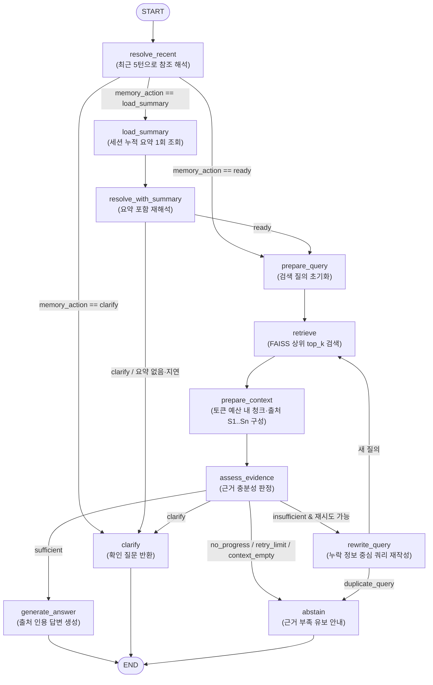

# RAG Service 아키텍처, 설계 전략 및 모듈 가이드

> **한눈에 보는 요약 (Quick Summary)**
> - **설계 목표**: 사내 인사규정 등 문서가 바뀌더라도 하드코딩 없이 **문맥 복원 → 근거 검색 → 충분성 판정 → 제한된 재검색 → 출처 인용 답변/확인 질문/답변 유보**를 일관되게 수행하는 세션형 RAG 서비스입니다.
> - **핵심 기술 스택**:
>   - **LangChain (LCEL)**: 진입 라우팅(`RunnableLambda | RunnableBranch`), 프롬프트 템플릿(`ChatPromptTemplate`), 구조화 출력(`with_structured_output(..., strict=True)`)을 담당합니다.
>   - **LangGraph (`StateGraph`)**: 단일 질문 안에서의 **대화 문맥 해석(최근 5턴 + 조건부 요약 1회)**과 **문서 검색·근거 평가·쿼리 재작성 루프(최대 1회 재시도)**를 상태 기계로 제어합니다.
> - **파일 구성**: [`rag_router.py`](rag_router.py)(진입 라우터) → [`rag_workflow.py`](rag_workflow.py)(LangGraph 그래프) → [`rag_agent.py`](rag_agent.py)(검색·컨텍스트·답변 생성), 그리고 상태를 정의하는 [`rag_state.py`](rag_state.py), 세션을 관리하는 [`session_memory.py`](session_memory.py)·[`rag_session.py`](rag_session.py), FastAPI 런타임을 연결하는 [`rag_api.py`](rag_api.py)로 역할을 엄격히 분리했습니다.

---

## 📑 목차 (Index)

1. [전체 아키텍처 및 핵심 요약 (Overview)](#1-전체-아키텍처-및-핵심-요약-overview)
2. [`rag-service` Python 파일별 역할 총정리](#2-rag-service-python-파일별-역할-총정리)
   - [2.1 핵심 모듈 요약 표](#21-핵심-모듈-요약-표)
   - [2.2 파일별 상세 역할과 주요 심볼](#22-파일별-상세-역할과-주요-심볼)
3. [RAG 설계 원칙 및 엔지니어링 전략](#3-rag-설계-원칙-및-엔지니어링-전략)
   - [3.1 입력 유형별 처리 정책](#31-입력-유형별-처리-정책)
   - [3.2 환각(Hallucination) 방지 및 출처 검증 전략](#32-환각hallucination-방지-및-출처-검증-전략)
   - [3.3 실행 예산(토큰·호출 수·시간) 통제 전략](#33-실행-예산토큰호출-수시간-통제-전략)
4. [LangChain 구현 설계 및 전략](#4-langchain-구현-설계-및-전략)
   - [4.1 LCEL 입력 분류 체인과 `RunnableBranch`](#41-lcel-입력-분류-체인과-runnablebranch)
   - [4.2 OpenAI Structured Outputs (`strict=True`) 및 중첩 Union 스키마](#42-openai-structured-outputs-stricttrue-및-중첩-union-스키마)
5. [LangGraph 구현 설계 및 전략](#5-langgraph-구현-설계-및-전략)
   - [5.1 다섯 묶음의 상태(`RagState`) 설계](#51-다섯-묶음의-상태ragstate-설계)
   - [5.2 전체 노드 흐름도 (Mermaid)](#52-전체-노드-흐름도-mermaid)
   - [5.3 단계별 노드 역할 및 전이(Transition) 조건](#53-단계별-노드-역할-및-전이transition-조건)
6. [세션 기억·증분 요약 및 무중단 스냅샷 전략](#6-세션-기억증분-요약-및-무중단-스냅샷-전략)
   - [6.1 최근 5턴 원문 + 조건부 누적 요약 조회](#61-최근-5턴-원문--조건부-누적-요약-조회)
   - [6.2 세션 동시성 제어(Lock), CAS 버전 관리, 멱등성(Idempotency)](#62-세션-동시성-제어lock-cas-버전-관리-멱등성idempotency)
   - [6.3 무중단 PDF 업로드와 FAISS 인덱스 스냅샷 교체](#63-무중단-pdf-업로드와-faiss-인덱스-스냅샷-교체)
7. [관련 설계·검증 문서 안내](#7-관련-설계검증-문서-안내)

---

## 1. 전체 아키텍처 및 핵심 요약 (Overview)

이 서비스는 무제한으로 도구를 호출하는 자율 에이전트(Autonomous Agent) 대신, **예측 가능하고 비용·지연이 통제되는 상태 기반 워크플로우(Controlled State Workflow)**를 채택했습니다.

```text
[클라이언트 / 콘솔 / 음성 서버]
       │  POST /rag-query (prompt, source, top_k, session_id, request_id)
       ▼
[진입점: rag_external-web_pdf_closed_llm.py] ──(상태·스냅샷 위임)──► [rag_api.py: RagRuntime]
       │
       ▼
[rag_router.py: RagService.ainvoke()]
  ├─ 1. 세션 잠금(SessionCoordinator) 및 최근 5턴 스냅샷 조회(InMemorySessionStore)
  ├─ 2. 동일 request_id 재전송 시 모델 호출 없이 저장된 응답 즉시 재생(Replay)
  ├─ 3. LangChain 입력 분류 (순수 인사 정규식 → SESSION_ROUTE_PROMPT → RunnableBranch)
  │     ├─ greeting / out_of_scope ──► 즉시 안내 응답 생성
  │     └─ document_question ────────► [rag_workflow.py: LangGraph 실행]
  │                                       ├─ A. 문맥 해석 (resolve_recent → 필요시 load_summary 1회)
  │                                       ├─ B. 벡터 검색 및 토큰 예산 내 컨텍스트 조립 (rag_agent.py)
  │                                       ├─ C. 근거 충분성 판정 (assess_evidence)
  │                                       ├─ D. 부족 시 쿼리 재작성 후 최대 1회 재검색 (rewrite_query)
  │                                       └─ E. 답변 생성(generate_answer) / 확인 질문(clarify) / 유보(abstain)
  └─ 4. 완료 턴 원자적 저장(CAS) 및 6턴 이상 시 증분 요약 갱신(refresh_summary)
```

[↑ 목차로 돌아가기](#-목차-index)

---

## 2. `rag-service` Python 파일별 역할 총정리

### 2.1 핵심 모듈 요약 표

| 분류 | 파일 경로 | 한 줄 역할 | 외부 API/프레임워크 의존 |
|---|---|---|---|
| **핵심 RAG** | [`rag_agent.py`](rag_agent.py) | FAISS 비동기/스레드 검색, 토큰 예산 내 컨텍스트 조립, 답변 생성 및 출처 인용(`[S1]`) 검증 | `langchain_core` |
| **상태·스키마** | [`rag_state.py`](rag_state.py) | LangGraph 5대 중첩 `RagState`, 설정(`RagSettings`), LLM 구조화 판정용 Pydantic 스키마 정의 | `pydantic`, `langchain_core` |
| **LangGraph** | [`rag_workflow.py`](rag_workflow.py) | 문맥 복원·요약 조회·검색·근거 평가·재검색·답변 생성 11개 노드로 구성된 `StateGraph` 및 예산 계측기(`RequestRuntime`) | `langgraph`, `langchain_core` |
| **LangChain 라우터** | [`rag_router.py`](rag_router.py) | 서비스 진입점(`RagService`). 입력 검증, LCEL 분류 분기, 세션 스냅샷 조회·턴 저장·요약 호출 조율 | `langchain_core`, `pydantic` |
| **세션 저장소** | [`session_memory.py`](session_memory.py) | 세션 생명주기, 최근 5턴 스냅샷, `request_id` 멱등성, 요약 커서·버전(CAS)을 관리하는 인메모리 저장소 | 표준 라이브러리 (`threading`, ` dataclasses`) |
| **세션 조정기** | [`rag_session.py`](rag_session.py) | 세션별 비동기 Lock 직렬화(`SessionCoordinator`) 및 완료 턴 이후의 LLM 증분 요약 실행 | `langchain_core` |
| **API 런타임** | [`rag_api.py`](rag_api.py) | FAISS 인덱스와 `RagService` 스냅샷 관리(`RagRuntime`), 세션 소유권 식별, 공개 출처 변환 및 테스트용 `create_app()` | `fastapi`, `pydantic` |
| **서버 진입점 (상위)** | [`../rag_external-web_pdf_closed_llm.py`](../rag_external-web_pdf_closed_llm.py) | `uvicorn` 실행 진입점. 전역 벡터스토어 로드 및 `/rag-query`, `/upload-paper`, `/sessions` 라우트 정의 | `fastapi`, `langchain_openai` |
| **전처리 (상위)** | [`../pdf_pipeline.py`](../pdf_pipeline.py), [`../ingest.py`](../ingest.py) | 규정 PDF 텍스트 추출, 조문/고정 크기 청킹, 메타데이터 부착, 원자적 FAISS 인덱스 저장 및 일괄 적재 CLI | `pypdf`, `faiss`, `langchain_openai` |

---

### 2.2 파일별 상세 역할과 주요 심볼

#### ① [`rag_agent.py`](rag_agent.py) — 검색·컨텍스트 조립·답변 생성 원시 모듈
FastAPI나 세션 DB를 전혀 몰라도 단독으로 호출할 수 있는 순수 RAG 실행 계층입니다.
- **`retrieve_documents(question, vectorstore, top_k)`**: 저장소의 비동기 검색(`asimilarity_search_with_score`)을 우선 호출하고, 동기 저장소면 `asyncio.to_thread`로 이벤트 루프 블로킹 없이 검색합니다.
- **`build_context(question, documents, count_tokens, max_input_tokens)`**: 청크 중간을 잘라내어 조건이나 예외 조항이 누락되는 일을 막기 위해, **청크 전체가 토큰 예산 안에 들어갈 때만** 포함합니다. 실제 포함된 순서대로 `[S1]`, `[S2]` 연속 ID를 부여합니다.
- **`generate_answer(messages, sources, llm)`**: LLM 응답 텍스트를 받아 정규식(`\[(S\d+)\]`)으로 인용된 출처 ID를 추출하고, 제공된 `sources`에 없는 출처 ID를 지어내면 `GenerationError`를 발생시킵니다.

#### ② [`rag_state.py`](rag_state.py) — 그래프 State 및 Pydantic 구조화 판정 스키마
자유 텍스트 파싱에 의존하지 않고 LLM의 모든 제어 판정을 엄격한 스키마로 검증합니다.
- **판정 스키마 (`StructuredDecision` 하위 클래스)**:
  - `InputDecision` / `RouteDecision`: 입력 의도(`greeting`, `document_question`, `out_of_scope`, 레거시 `clarify`) 분류.
  - `MemoryDecisionOutput` (`ReadyMemory | LoadMemory | ClarifyMemory` 중첩 Union) 및 `MemoryDecision`: 최근 대화/요약 기반 문맥 해석 판정.
  - `EvidenceDecision`: 검색된 문서가 질문에 답하기에 충분한지(`sufficient` / `insufficient` / `clarify`), 근거 ID(`supported_source_ids`)와 부족한 정보(`missing_information`)가 무엇인지 판정.
  - `RewrittenQuery`, `SummaryDecision`: 재검색 쿼리 및 누적 요약 출력 스키마.
- **`RagSettings`**: `top_k`(기본 5), `max_retries`(기본 1), `max_input_tokens`(6,000), `max_total_input_tokens`(24,000), `max_model_calls`(8), `timeout_seconds`(45~60초) 등 실행 한도를 불변 데이터클래스로 검증합니다.
- **`RagState`**: 단일 요청의 상태를 `request`, `memory`, `interpretation`, `retrieval`, `result` 5개 중첩 `TypedDict`로 구조화합니다.

#### ③ [`rag_workflow.py`](rag_workflow.py) — 문서 질의용 LangGraph 상태 기계와 예산 계측
- **`RequestRuntime`**: 요청마다 새로 생성되며, 모든 LLM 호출 전후에 메시지 토큰 수와 실제 `usage_metadata`를 합산해 호출 횟수·입력 토큰 한도를 넘으면 즉시 `BudgetExceeded`로 차단합니다.
- **`compile_document_graph(vectorstore, llm, settings, session_store)`**: 문맥 해석부터 검색·근거 평가·재검색·답변 생성까지의 11개 노드를 가진 `StateGraph(RagState)`를 컴파일해 반환합니다.

#### ④ [`rag_router.py`](rag_router.py) — LangChain 라우터 및 요청 생명주기 총괄 (`RagService`)
- **`RagService`**: 컴파일된 LangChain 체인(`self.chain`)과 LangGraph(`self.graph`)를 보관하며, `ainvoke()` 호출마다 독립된 `RequestRuntime`과 `RagState`를 생성해 실행합니다.
- 세션 모드에서는 `SessionCoordinator.hold(session_id)`로 동일 세션 요청을 직렬화하고, `get_context` → 중복 요청 재생 확인 → 체인/그래프 실행 → `append_turn` → `refresh_summary`까지를 하나의 타임아웃 예산 안에서 처리합니다.

#### ⑤ [`session_memory.py`](session_memory.py) — 세션 원문·요약·버전(CAS) 저장소
- **`SessionStore` (Protocol)** 및 **`InMemorySessionStore`**:
  - 세션별 전체 완료 턴(`Turn`), 요청 ID 맵(`requests`), 누적 요약(`Summary`), 버전(`version`), 만료 시각(`expires_at`, 기본 1,800초)을 `threading.RLock`으로 보호합니다.
  - 모든 조회 결과(`SessionSnapshot`, `SessionContext`, `SummaryWork`)를 불변(Frozen) 스냅샷으로 반환하여 그래프 실행 중 외부 변경에 오염되지 않게 합니다.

#### ⑥ [`rag_session.py`](rag_session.py) — 세션 직렬화 및 증분 요약 (`SessionCoordinator`)
- **`SessionCoordinator.hold(session_id)`**: 대기자 수를 포함한 참조 카운팅(`entry[1]`)으로 비동기 `asyncio.Lock`을 관리하고, 마지막 요청이 끝나면 Lock 엔트리를 자동 정리합니다.
- **`SessionCoordinator.refresh_summary(session_id, version, rt)`**: 최근 5턴 밖으로 밀려난 미요약 구간(`SummaryWork.turns`)이 있을 때만 LLM으로 이전 요약과 합쳐 새 요약을 만들고 `update_summary`로 저장합니다.

#### ⑦ [`rag_api.py`](rag_api.py) — FastAPI 런타임·스냅샷 관리 및 테스트 팩토리
- **`RagRuntime`**: `(source, top_k, revision)` 키별로 `RagService`를 캐싱하고, PDF 업로드 시 기존 인덱스를 복제·갱신한 뒤 `revision`을 올려 무중단 스냅샷 교체를 수행합니다.
- **`client_owner` / `public_sources`**: 세션 소유권 해시 계산 및 내부 청크 본문(`text`)을 제외한 공개 출처 메타데이터 변환을 담당합니다.
- **`create_app(**kwargs)`**: 진입점([`rag_external-web_pdf_closed_llm.py`](../rag_external-web_pdf_closed_llm.py))의 엔드포인트 함수들을 바인딩하여 모의 모델·임시 인덱스로 테스트할 수 있는 FastAPI 인스턴스를 생성합니다.

[↑ 목차로 돌아가기](#-목차-index)

---

## 3. RAG 설계 원칙 및 엔지니어링 전략

### 3.1 입력 유형별 처리 정책
모든 입력을 무조건 벡터 검색에 넣지 않고, 규칙과 경량 분류로 먼저 거릅니다.

| 입력 상황 | 예시 | 처리 전략 |
|---|---|---|
| **빈 입력 / 형식 오류** | 공백, 4,000자 초과, 잘못된 `top_k` | Python 검증에서 즉시 거부 (`422`), LLM·검색 호출 없음 |
| **순수 인사** | `"안녕하세요!"`, `"반갑습니다"` | 정규식(`GREETING.fullmatch`)으로 즉시 감지해 고정 인사 반환 (LLM 호출 0회) |
| **인사 + 질문** | `"안녕하세요, 연차는 며칠인가요?"` | 정규식에 매칭되지 않으며 분류기가 `document_question`으로 그래프에 전달 |
| **짧지만 주제가 있는 입력** | `"연차?"`, `"경조금"` | 길이만으로 차단하지 않고 `document_question`으로 그래프에 전달 |
| **후속·참조 질문** | `"그럼 지급은?"`, `"아까 처음에 물어본 거"` | 라우터에서 조기 종료하지 않고 그래프의 기억 노드(`resolve_recent` / `load_summary`)로 전달 |
| **근거 없는 질문** | `"사내 주차장 요금은?"` | 검색 및 1회 재검색 후에도 근거가 없으면 추측하지 않고 `no_evidence`(답변 유보) 반환 |

### 3.2 환각(Hallucination) 방지 및 출처 검증 전략
1. **프롬프트 및 데이터 격리**: 검색된 문서는 `<reference_documents>` 태그와 JSON 메타데이터로 감싸고, 문서 내부의 지시문이나 역할 변경 명령(Prompt Injection)을 따르지 않도록 모든 시스템 프롬프트에 명시했습니다.
2. **평가와 생성의 분리**: 검색 결과를 바로 답변 생성에 쓰지 않고, `assess_evidence` 노드가 먼저 질문에 필요한 정보가 근거에 실제로 있는지 검증합니다.
3. **인용 ID 사후 검증**: 답변 본문에 `[S1]` 등 출처 표기를 강제하고, [`generate_answer`](rag_agent.py)에서 실제로 컨텍스트에 포함된 `S1`~`Sn` 집합의 부분집합인지 정규식으로 검사합니다.
4. **대화 기억과 문서 사실의 분리**: 이전 대화의 `assistant` 답변이나 요약은 **"무엇을 물어보는지(참조 대상)"를 해석하는 데만 사용**하며, 규정의 사실 근거로 삼지 않습니다.

### 3.3 실행 예산(토큰·호출 수·시간) 통제 전략
- **단일 호출 입력 예산 (`max_input_tokens=6000`)**: 컨텍스트 조립 시(`build_context`) 질문+지시문+청크 합계가 예산을 넘지 않도록 청크 단위로 배치합니다.
- **요청 누적 예산 (`max_total_input_tokens=24000`, `max_model_calls=8`)**: [`RequestRuntime.invoke`](rag_workflow.py)가 사전 추정 토큰과 사후 실제 `usage_metadata.input_tokens` 중 큰 값으로 예산을 보정하여, 루프나 요약이 예산을 초과하면 즉시 중단합니다.
- **전체 시간 제한 (`timeout_seconds=60`)**: 세션 대기·분류·그래프 실행·턴 저장·요약 갱신 전체를 단일 `asyncio.timeout`으로 감쌉니다.

[↑ 목차로 돌아가기](#-목차-index)

---

## 4. LangChain 구현 설계 및 전략

### 4.1 LCEL 입력 분류 체인과 `RunnableBranch`
[`rag_router.py`](rag_router.py)의 `RagService`는 LangChain Expression Language(LCEL)로 진입 파이프라인을 구성합니다.

```python
self.chain = RunnableLambda(self._classify) | RunnableBranch(
    (lambda x: x["route"].intent == "greeting", RunnableLambda(self._greet)),
    (lambda x: x["route"].intent == "clarify" and self.sessions is None, RunnableLambda(self._clarify)),
    (lambda x: x["route"].intent == "out_of_scope", RunnableLambda(self._out_of_scope)),
    RunnableLambda(self._document),
)
```
- **핵심 설계 포인트**: 세션 모드(`self.sessions is not None`)에서는 입력 분류 스키마에서 `clarify`를 아예 제외한 `InputDecision`(`greeting | document_question | out_of_scope`)을 사용합니다. 그래야 `"그럼 신청은?"`이나 `"아까 그거"`처럼 모호한 입력이 라우터에서 끊기지 않고 LangGraph의 기억 해석 노드(`resolve_recent` → `load_summary`)까지 도달할 수 있습니다.

### 4.2 OpenAI Structured Outputs (`strict=True`) 및 중첩 Union 스키마
모든 제어 판정 모델은 `llm.with_structured_output(Schema, include_raw=True, strict=True)`로 바인딩합니다.
- **실제 운영 중 발견해 해결한 설계 포인트**:
  1. 단일 평면 스키마에서 `action` 값에 따라 어떤 필드는 채우고 어떤 필드는 `null`로 두게 하면, 실제 LLM(GPT-4o)이 간혹 `action="ready"`인데 `missing_reference`를 함께 채우는 등 필드 조합 오류가 발생했습니다. 이를 해결하기 위해 Wire 스키마인 [`MemoryDecisionOutput`](rag_state.py)을 **`ReadyMemory | LoadMemory | ClarifyMemory` 중첩 Union**으로 정의해 JSON Schema 수준에서 허용된 필드 조합만 생성되도록 강제했습니다.
  2. 제어 분기에 쓰이지 않는 설명용 `reason_code`가 빈 문자열로 반환되어 전체 판정이 거부되는 문제를 막기 위해, Wire 스키마에서는 `reason_code`를 제거하고 Python 코드가 확정된 분기에 따라 `reason_code`를 부여하도록 설계했습니다.

[↑ 목차로 돌아가기](#-목차-index)

---

## 5. LangGraph 구현 설계 및 전략

### 5.1 다섯 묶음의 상태(`RagState`) 설계
[`rag_state.py`](rag_state.py)의 `RagState`는 역할과 생명주기가 다른 데이터들이 섞이지 않도록 5개의 중첩 `TypedDict`로 나뉩니다.

| State 묶음 | 주요 필드 | 설계 의도 |
|---|---|---|
| **`request`** | `request_id`, `original_question` | 요청 내내 절대 변하지 않는 사용자 원질문과 식별자 보존 |
| **`memory`** | `session_id`, `session_version`, `recent_history`, `summary_available`, `summary_checked`, `summary_status`, `summary` | 세션 저장소에서 읽어 온 최근 5턴 스냅샷과 지연 로드(Lazy-load)된 요약 정보 |
| **`interpretation`** | `memory_action`, `standalone_question`, `missing_reference`, `clarification_question` | 문맥을 복원한 독립 질문 또는 사용자에게 되물을 확인 질문 |
| **`retrieval`** | `search_query`, `previous_queries`, `search_count`, `current_documents`, `messages`, `sources`, `previous_evidence_ids`, `evidence_decision`, `missing_information` | 검색 루프 상태. 매 검색 회차마다 현재 문서·메시지·출처를 교체하며 이전 근거 해시(`previous_evidence_ids`)로 진전 여부를 비교 |
| **`result`** | `status`, `output`, `reason_code` | 그래프 종료 시점의 최종 상태(`answered`, `clarification_needed`, `no_evidence` 등)와 응답 텍스트 |

> [!NOTE]
> 모델 객체(`llm`), 벡터 저장소(`vectorstore`), 세션 저장소(`session_store`)는 직렬화 대상 상태(`RagState`)에 넣지 않고 그래프 컴파일 시 클로저로 주입하며, 요청별 계측기(`RequestRuntime`)는 `RunnableConfig["configurable"]["runtime"]`으로 전달합니다.

---

### 5.2 전체 노드 흐름도 (Mermaid)



---

### 5.3 단계별 노드 역할 및 전이(Transition) 조건

1. **`resolve_recent` → `load_summary` → `resolve_with_summary` (기억 해석 구간)**
   - 먼저 최근 완료 5턴(`recent_history`)만으로 현재 질문을 독립된 검색 질문(`standalone_question`)으로 만들 수 있는지 판단합니다.
   - `"아까 처음에 물어본 규정"`처럼 과거 대화를 가리키지만 최근 5턴에 대상이 없고 `summary_available=True`이면 `load_summary`로 전이해 저장소에서 요약을 딱 한 번 읽어옵니다.
   - 요약이 비어 있거나 이전 요약 갱신이 실패해 최신 상태가 아니면(`not summary_is_current`), 불완전한 요약으로 추측하지 않고 즉시 `clarify`로 전이해 사용자에게 확인을 요청합니다.
2. **`prepare_query` → `retrieve` → `prepare_context` (검색 및 컨텍스트 구성 구간)**
   - 복원된 `standalone_question`으로 첫 검색을 수행하고, 만약 원질문(`original_question`)과 복원 질문이 다르면 생성 프롬프트에 두 질문을 함께 표시해 원래 질문 의도가 왜곡되지 않게 합니다.
3. **`assess_evidence` → `rewrite_query` (근거 평가 및 제한된 재검색 루프)**
   - 각 출처의 `(chunk_id, metadata, text)` SHA-256 해시 목록(`fingerprints`)을 계산합니다.
   - `decision == "insufficient"`일 때 다음 세 경우 중 하나면 재검색하지 않고 즉시 `abstain`으로 종료합니다:
     - **`no_progress`**: 재검색 후에도 근거 해시 목록과 부족한 정보 목록이 이전 회차와 완전히 동일한 경우
     - **`retry_limit`**: 재검색 횟수(`search_count - 1`)가 `settings.max_retries`(기본 1회)에 도달한 경우
     - **`context_empty`**: 검색된 후보는 있으나 토큰 예산 등을 이유로 컨텍스트에 담긴 출처가 0개인 경우
   - 재검색이 가능하면 `rewrite_query` 노드가 누락된 정보(`missing_information`)를 찾도록 검색어를 재작성하되, 정규화한 검색어가 이전 질의(`previous_queries`)와 중복되면(`duplicate_query`) 재검색 없이 `abstain`으로 종료합니다.

[↑ 목차로 돌아가기](#-목차-index)

---

## 6. 세션 기억·증분 요약 및 무중단 스냅샷 전략

### 6.1 최근 5턴 원문 + 조건부 누적 요약 조회
- **왜 5턴 + 증분 요약인가?**: 모든 과거 대화를 매번 프롬프트에 넣으면 대화가 길어질수록 토큰 비용과 지연이 선형 증가하고 오래된 문맥이 현재 질문을 오염시킵니다.
- 따라서 **최근 완료 5턴은 원문 그대로** 전달해 즉각적인 후속 질문을 정확히 처리하고, **6번째 턴부터 최근 5턴 밖으로 밀려난 오래된 턴들은 `SessionCoordinator.refresh_summary`를 통해 누적 요약(`Summary`)으로 압축**합니다.
- 요약 갱신이 일시적 네트워크/모델 오류로 실패하더라도, 이미 생성된 본 답변은 정상 반환하고 `summary_update_status="failed"` 및 `warning`만 표시한 뒤 다음 턴에서 미요약 구간 전체를 다시 요약합니다.

### 6.2 세션 동시성 제어(Lock), CAS 버전 관리, 멱등성(Idempotency)
- **세션 직렬화**: 같은 `session_id`로 동시에 들어온 요청들은 [`SessionCoordinator.hold`](rag_session.py)의 세션별 비동기 Lock을 통해 순서대로 실행됩니다.
- **낙관적 버전 검증 (CAS)**: [`InMemorySessionStore`](session_memory.py)의 모든 쓰기(`append_turn`, `update_summary`)는 요청 시작 시 읽은 `expected_version`과 현재 세션 `version`을 비교해 불일치 시 `SessionVersionConflict`를 발생시킵니다.
- **요청 멱등성 (`request_id`)**: 네트워크 재시도로 같은 `(session_id, request_id, question)`이 다시 들어오면 LLM이나 검색을 다시 호출하지 않고 저장된 결과를 즉시 재생(`replayed=True`, `model_calls=0`)합니다. 만약 같은 `request_id`에 다른 질문을 보내면 `RequestConflict`(`409`)로 차단합니다.

### 6.3 무중단 PDF 업로드와 FAISS 인덱스 스냅샷 교체
- 실행 중인 서버에서 `POST /upload-paper`로 규정을 새로 올릴 때 기존 메모리 인덱스를 직접 수정하면 진행 중인 질의가 깨지거나 실패 시 인덱스가 손상될 수 있습니다.
- [`RagRuntime.upload`](rag_api.py)와 [`pdf_pipeline.save_store`](../pdf_pipeline.py)는 다음과 같이 동작합니다:
  1. 기존 FAISS 인덱스를 메모리에서 복제(`clone_store`)한 뒤, 업로드된 파일명(`source`)의 기존 청크만 지우고 새 청크를 임베딩·추가(`upsert`)합니다.
  2. 디스크 저장 시 임시 스테이징 폴더(`*-stage-*`)에 먼저 저장을 완료한 뒤 원자적 디렉터리 교체(실패 시 백업 롤백)를 수행합니다.
  3. 디스크 저장까지 성공한 뒤에만 `state_lock` 안에서 메모리 참조(`stores["pdf"]`)를 교체하고 `corpus_revision`을 1 증가시킵니다.
  4. 이전 `corpus_revision`에서 만들어진 세션으로 후속 질문이 들어오면 `409 Conflict`를 반환해 갱신된 규정 기준으로 새 대화를 시작하도록 안내합니다.

[↑ 목차로 돌아가기](#-목차-index)

---

## 7. 관련 설계·검증 문서 안내

더 자세한 배경 설계와 단계별 실험·평가 기록은 상위 [`rag-docs/`](../../rag-docs/) 폴더의 문서를 참고하세요.

- **설계 및 전략 문서**
  - [LangChain·LangGraph 기반 RAG 개발 전략](../../rag-docs/LANGCHAIN_LANGGRAPH_RAG_STRATEGY.md)
  - [RAG 노드·State 정의 전략](../../rag-docs/RAG_STATE_DESIGN.md)
  - [세션 기억·요약 조회를 포함한 LangGraph 구체화 전략](../../rag-docs/LANGGRAPH_MEMORY_WORKFLOW_PLAN.md)
  - [신규 인사규정 문서와 RAG 연결 방향](../../rag-docs/HR_DOCUMENT_INTEGRATION_PLAN.md)
- **사용법 및 계약 문서**
  - [현재 모듈 실행 안내 (`README.md`)](README.md)
  - [세션 기억을 연결한 RAG 사용법](../../rag-docs/SESSION_RAG_WORKFLOW_USAGE.md)
  - [SessionStore 단독 사용법](../../rag-docs/SESSION_MEMORY_USAGE.md)
  - [인사규정 RAG HTTP API 계약 및 사용법](../../rag-docs/HR_RAG_API_USAGE.md)
- **평가 및 연결 결과**
  - [인사규정 RAG 단계별 연결 및 평가 결과](../../rag-docs/HR_RAG_INTEGRATION_RESULT.md)
  - [평가 스크립트 실행 안내 (`evaluation/README.md`)](evaluation/README.md)

[↑ 목차로 돌아가기](#-목차-index)
