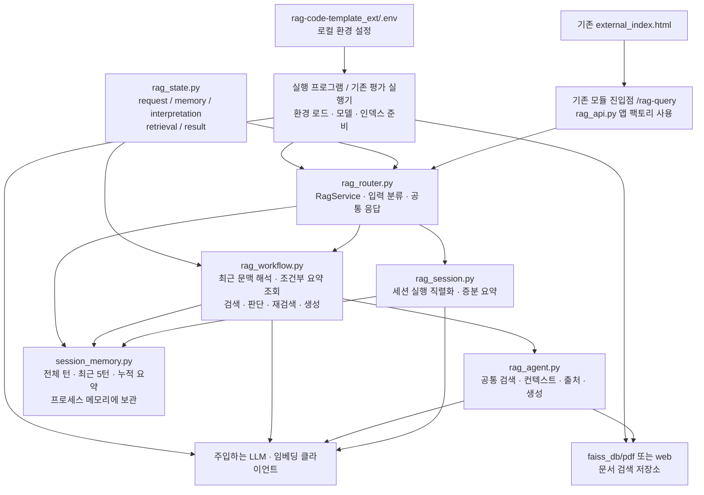

# RAG 서비스 디렉터리 구조

갱신일: 2026-10-25 (Asia/Seoul)

현재 개발 중인 서비스는 `rag-code-template_ext/rag-service/`다. 공용 환경 설정·패키지 의존성·FAISS 데이터는 상위 `rag-code-template_ext/`에 둔다. 기존 uvicorn 진입점·음성 프록시·콘솔·Vue 화면을 새 세션 RAG에 연결했다. [최신 API 실행 안내](../rag-docs/HR_RAG_API_USAGE.md)를 참고한다.

## 디렉터리 구조도

`[준비 위치]`는 현재 파일·폴더가 없고 실행 환경을 구성할 때 생성할 위치다. 캐시 파일은 생략했다. `runs/`와 `comparisons/`는 하위 산출물을 묶어 표시했다.

```text
Skala-mini-project/
├── .gitignore                              # .env 제외 규칙
├── RUN.md                                  # 전체 프로젝트 실행 안내
├── data/regulations/                       # 입력 인사규정 PDF 5종
├── frontend/                               # Vue 화면·세션 상태·음성 API 호출
├── voice-ai_code/app/                      # 인증된 음성/텍스트 프록시·STT·TTS
├── rag-code-template_ext/
│   ├── .env                                # 공용 API 키·환경 설정 (Git 제외)
│   ├── .env.example                        # 비밀값 없는 설정 이름·기본 모델
│   ├── .venv/                              # [준비 위치] 프로젝트용 Python 가상환경
│   │   └── Scripts/python.exe              # Windows 기준 실행 파일
│   ├── .gitignore                          # .env·.venv·Python 캐시 등 제외
│   ├── pdf_pipeline.py                     # 추출·정제·청킹·복제·안전 적재
│   ├── ingest.py                           # dry-run·일괄 적재·별도 출력 경로
│   ├── requirements-e.txt                  # 기존 서버·공용 Python 의존성
│   ├── 프로젝트 구조.md                    # 이 문서
│   ├── rag_external-web_pdf_closed_llm.py   # 기존 FastAPI 서버
│   ├── external_index.html                 # 기존 외부 RAG 화면
│   ├── faiss_db/                           # 디스크에 보관하는 검색 데이터
│   │   ├── pdf/
│   │   │   ├── index.faiss                  # PDF 벡터 인덱스
│   │   │   └── index.pkl                    # PDF 문서·메타데이터
│   │   └── web/
│   │       ├── index.faiss                  # 웹 벡터 인덱스
│   │       └── index.pkl                    # 웹 문서·메타데이터
│   └── rag-service/                        # 현재 개발 중인 독립 RAG 모듈
│       ├── README.md                       # 설치·테스트·import 경로 안내
│       ├── requirements-rag-workflow.txt   # ../requirements-e.txt 포함 + LangGraph
│       ├── rag_api.py                      # API 팩토리·세션 소유권·업로드·인덱스 교체
│       ├── rag_state.py                    # 다섯 묶음 State·판정 스키마·실행 설정
│       ├── rag_router.py                   # RagService 진입점·입력 분류·응답 구성
│       ├── rag_workflow.py                 # 기억 해석·검색·판정·재검색·생성 그래프
│       ├── rag_agent.py                    # 기본 RAG·검색·컨텍스트·출처·생성 함수
│       ├── session_memory.py               # 세션 저장 계약·메모리 구현·TTL·CAS
│       ├── rag_session.py                  # 세션 실행 직렬화·증분 요약 갱신
│       ├── tests/
│       │   ├── test_rag_api.py             # HTTP 세션·업로드·원본 보존 검증
│       │   ├── test_rag_agent.py           # 기본 RAG 동작
│       │   ├── test_rag_workflow.py        # 라우팅·검색 그래프·예산·종료 조건
│       │   ├── test_session_memory.py      # 세션 저장소·만료·중복·충돌
│       │   ├── test_memory_workflow.py     # 세션·기억·요약·동시 요청 통합
│       │   └── test_evaluation.py          # 평가 지표·기록·비교 계산
│       └── evaluation/
│           ├── README.md                   # 평가 실행 안내
│           ├── corpus.jsonl                # 기존 PDF 청크 목록 44개
│           ├── questions.jsonl             # 기존 평가 질문 24개
│           ├── run_hr_session_evaluation.py # 실제 LLM 인사규정 다중 턴 평가
│           ├── run_hr_api_smoke.py          # 실제 임베딩 업로드·질의 평가
│           ├── inspections/                # 원문·청킹 점검 및 화면 확인
│           ├── run_evaluation.py           # 실제 FAISS·LLM 기본 평가 실행기
│           ├── run_workflow_smoke.py       # 기존 라우터·그래프의 6개 사례 평가
│           ├── compare_runs.py             # 완료된 top_k 실험 결과 비교
│           ├── runs/                       # baseline·top_k·workflow_smoke 결과
│           └── comparisons/                # top_k 비교 결과·리포트
└── rag-docs/
    ├── SESSION_RAG_WORKFLOW_USAGE.md        # 최신 세션 RAG 호출·응답·제약
    ├── SESSION_MEMORY_USAGE.md             # SessionStore 단독 계약·사용법
    ├── RAG_STATE_DESIGN.md                 # State 설계 및 반영 상태
    ├── LANGGRAPH_MEMORY_WORKFLOW_PLAN.md    # 기억 그래프 전략 및 반영 상태
    ├── RAG_ROUTER_WORKFLOW_USAGE.md         # 기존 호출 호환·라우팅·그래프 안내
    ├── ...                                # 개발 계획·RAG 평가 결과 문서
    └── 작업기록/                           # 요청별 한국어 작업 로그
```

`rag-service/.env`와 `rag-service/.venv`를 별도로 만들 필요는 없다. 프로젝트용 가상환경은 위 위치가 준비 경로이며, 앞선 테스트에서 사용한 검증용 Python 3.12 환경은 저장소 밖에 있다. `rag-service`는 디렉터리 이름으로 사용하며 Python import는 `from rag_router import RagService`처럼 한다. 직접 호출할 때 이 디렉터리를 작업 디렉터리 또는 `PYTHONPATH`로 설정한다.

## .env 위치와 항목

공용 환경 파일 위치는 **`rag-code-template_ext/.env`**다. 실제 키는 문서나 코드에 넣지 않는다. 아래는 필요한 변수 이름만 보여주는 빈 예시다.

```dotenv
# 기존 PDF 인덱스를 이용한 실제 LLM 평가
OPENAI_API_KEY=

# 기존 서버의 네이버 웹 검색을 사용할 때 추가
NAVER_CLIENT_ID=
NAVER_CLIENT_SECRET=

# 기존 서버의 DB 연결 설정이 필요할 때 추가
# ASYNC_DB_URL=
```

| 항목 | 사용 범위 | 현재 세션 RAG 평가에 필요한가 |
|---|---|---|
| OPENAI_API_KEY | 질문 임베딩·분류·기억 해석·답변 생성·요약 | 필요 |
| NAVER_CLIENT_ID / NAVER_CLIENT_SECRET | 현재 PDF API에서 사용하지 않음 | 불필요 |
| ASYNC_DB_URL | 새 세션 API에서 사용하지 않음 | 불필요 |

현재 공용 `.env`가 존재하며 OPENAI_API_KEY가 설정되어 있다. 실제 OpenAI 인증과 GPT-4o 접근·임베딩·질의를 확인했다. 키 값은 문서에 기록하지 않는다. 기존 평가 실행기는 자신의 파일 위치를 기준으로 상위 프로젝트의 `.env`를 로드한다. `RagService` 자체는 `.env`를 읽거나 모델·인덱스를 생성하지 않으므로 직접 사용하는 실행 프로그램이 환경 로드와 의존성 주입을 담당한다. 기존 FastAPI도 서버 파일과 같은 폴더의 `.env`를 읽는다.

## 모듈 연결도

실선은 현재 연결된 경로다. 모델·저장소는 서비스에 주입하며 State에 넣지 않는다.



기존 `run_workflow_smoke.py`는 세션 저장소를 주입하지 않는 호환 호출을 평가한다. 새 세션·자동 요약은 run_hr_session_evaluation.py, 실제 업로드는 run_hr_api_smoke.py로 평가한다. 위 연결도는 서비스의 선택적 세션 모드를 포함한 모듈 관계이며, 기존 평가 스크립트가 세션 모드까지 실행한다는 뜻은 아니다.

## 저장 위치와 현재 상태

| 데이터·설정 | 위치 | 유지 범위 |
|---|---|---|
| 환경 설정·API 키 | `rag-code-template_ext/.env` 또는 실행 환경변수 | 로컬 실행 환경 |
| PDF·웹 검색 데이터 | `rag-code-template_ext/faiss_db/` | 디스크 저장 |
| 전체 대화·누적 요약·세션 버전 | `InMemorySessionStore` 내부 메모리 | 해당 프로세스·세션 수명 동안 |
| 요청 State·호출 수·토큰·trace | 요청마다 생성 | 질문 1건 |
| 평가 결과·설정·리포트 | `rag-service/evaluation/runs/`, `comparisons/` | 디스크 저장 |

세션 데이터를 저장하는 별도 디렉터리나 DB는 아직 없다. 메모리 세션은 기본 TTL 30분이며 프로세스를 재시작하면 사라진다. 여러 워커 간 공유·실행 직렬화는 별도 구현이 필요하다.

독립 세션 서비스의 State·기억 조회·완료 턴 저장·증분 요약과 API·화면 연결을 구현했다. 실제 소규모 다중 턴·업로드 평가를 수행했다. session_facts 도메인 조건 저장, OCR·전체 표 복원, 배포용 인증·다중 워커 공유는 별도 범위다.

API 기본 FAISS 경로는 소스 위치에서 계산하며 RAG_INDEX_PATH 상대 경로는 rag-code-template_ext 기준이다. 업로드는 완성된 새 인덱스로 교체하고 진행 중 질의는 기존 스냅샷을 유지한다. CLI로 지정한 상대 출력 경로는 실행 작업 디렉터리 기준이다.

## 관련 안내

- [RAG 모듈 설치·테스트·Python import](rag-service/README.md)
- [세션 RAG 최신 사용법](../rag-docs/SESSION_RAG_WORKFLOW_USAGE.md)
- [평가 실행 안내](rag-service/evaluation/README.md)
- [전체 프로젝트 실행 안내](../RUN.md)
