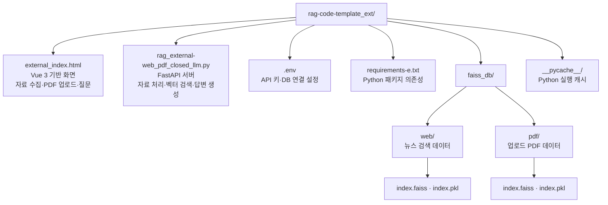
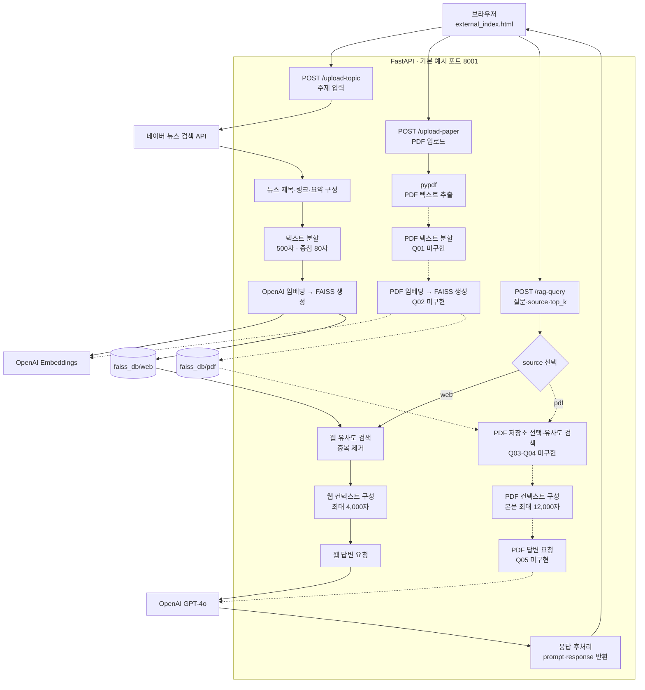

# rag-code-template_ext 프로젝트 구조

이 프로젝트는 Vue 기반 단일 HTML 화면, FastAPI 서버, 웹/PDF별 FAISS 벡터 저장소로 구성되어 있습니다.

## 디렉터리 구조

## 자료 수집 및 질의 응답 흐름

점선은 현재 코드에서 `...`로 남아 있는 PDF 실습 구현 부분입니다.

## 구현 상태 및 참고사항

- `rag_external-web_pdf_closed_llm.py`는 라우터, 요청·응답 모델, 전처리, 검색, LLM 호출을 한 파일에서 처리합니다.
- 서버 시작 시 기존 FAISS 파일을 메모리에 로드합니다. 새 자료를 수집하면 해당 저장소를 다시 생성해 디스크에 저장합니다.
- 웹 수집은 네이버 뉴스 검색 결과의 제목·링크·요약을 사용하며, 기사 본문을 직접 수집하지 않습니다.
- PDF 경로의 Q01~Q05는 미완성입니다. 청크 설정, 임베딩 및 FAISS 생성, PDF 저장소 선택, 유사도 검색, LLM 호출을 구현해야 합니다.
- SQLAlchemy의 MySQL 비동기 엔진을 생성하지만, 실제 API 처리에서 관계형 DB를 사용하는 코드는 없습니다.
- `.env`는 Python 파일 위치를 기준으로 읽고, `faiss_db`는 실행 작업 디렉터리를 기준으로 접근합니다.

## 주요 파일

| 파일/경로 | 역할 |
| --- | --- |
| `external_index.html` | Vue 3 기반 사용자 화면 및 API 호출 |
| `rag_external-web_pdf_closed_llm.py` | FastAPI 서버와 RAG 처리 |
| `requirements-e.txt` | Python 패키지 의존성 |
| `.env` | API 키와 DB 연결 환경 설정 |
| `faiss_db/web/` | 웹 자료의 벡터 인덱스 및 문서 데이터 |
| `faiss_db/pdf/` | PDF 자료의 벡터 인덱스 및 문서 데이터 |
