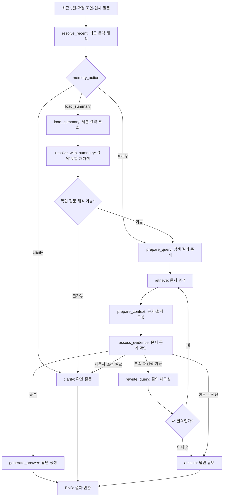

# 세션 기억·요약 조회를 포함한 LangGraph 구체화 전략

작성일: 2026-10-23 (Asia/Seoul)  
상태: 2026-10-25 State·조건부 기억 조회·세션 턴 저장·증분 요약을 구현하고 모의 통합 테스트를 추가했다. 실제 모델 평가와 API·화면 연결은 남아 있다.

현재 호출 계약과 제약은 [세션 RAG 사용법](SESSION_RAG_WORKFLOW_USAGE.md), 저장소 단독 계약은 [SessionStore 사용법](SESSION_MEMORY_USAGE.md)을 참고한다. 아래 변경 방향·구현 순서는 최초 설계 기록이다. session_facts 자동 추출은 미구현이며 요약은 응답 반환 전에 같은 시간·호출 예산 안에서 갱신한다.

## 1. 목표와 합의 기준

현재 문서 검색 그래프 앞에 대화 문맥 해석과 조건부 요약 조회를 추가한다.

- 사용자별 장기 기억 대신 하나의 대화 세션 안에서만 기억을 유지한다.
- 직접 참조는 최근 **완료된 5턴**을 기본으로 한다. 1턴은 질문·최종 응답 한 쌍이다.
- 오래된 대화는 세션 원문과 누적 요약으로 보관한다. 5턴을 넘었다고 삭제하지 않는다.
- 최근 대화만으로 질문을 해석할 수 없고 과거 대화의 참조 대상이 필요할 때 요약을 조회한다.
- 사용자가 확정한 중요한 조건은 별도 session_facts로 전달해 오래됐다는 이유로 놓치지 않는다.
- 기억은 질문 이해용이며 문서 사실의 근거가 아니다. 이전 답변의 사실성을 그대로 신뢰하지 않는다.
- 요약 조회 최대 1회와 문서 재검색 기본 1회·설정 최대 2회를 별도로 관리한다.
- 외부 최종 답변 필드는 `output`을 목표로 한다. 현재 구현의 `answer`는 연결 계층에서 매핑한다.

## 2. 최초 구현에서의 변경 지점

다음 표는 기억 연결 전 구현과 당시 변경 계획이다.

| 파일 | 현재 역할 | 변경 방향 |
|---|---|---|
| `rag_router.py` | 질문·전달된 이력으로 분류·독립 질문 복원 | 세션 진입과 분류에 집중, 과거 참조 해석은 그래프에 위임 |
| `rag_workflow.py` | 검색·컨텍스트·근거 판단·재검색·생성 | 검색 앞에 문맥 해석·요약 조회 노드 추가 |
| `rag_state.py` | 요청별 질문·검색·반복·판정 상태 | 기억 관련 State와 판정 스키마 추가 |
| `rag_agent.py` | 공통 검색·컨텍스트·생성 | 재사용, 세션 저장 책임 추가하지 않음 |
| 새 `session_memory.py` (제안) | 없음 | 세션 원문·요약·확정 조건·만료 관리 |

**현재 라우터는 일부 모호한 입력을 바로 확인 질문으로 종료한다.** 이 동작을 그대로 두면
그래프에 요약 조회를 추가해도 ‘아까 그거’ 같은 입력이 거기까지 도달하지 못할 수 있다.
따라서 문서 질문일 수 있는 모호한 입력은 그래프로 보내고 문맥 해석 후 확인하도록 바꾼다.

라우터는 빈 입력 검증, 순수 인사, 명시적으로 지원 범위 밖인 요청을 처리한다.
질문 대상의 복원은 그래프에서 담당해 같은 역할의 모델 호출을 중복하지 않는다.
문서 경로에서 standalone_question을 반드시 생성해야 한다는 기존 RouteDecision 계약도
완화하거나 해당 필드를 그래프의 MemoryDecision으로 옮겨야 한다.

## 3. 전체 그래프



요약 조회 경로는 검색 전 한 번만 통과한다. 문서 검색이 실패했다고 이 경로로 되돌아가지 않는다.
그래프 종료 뒤 세션 관리 계층이 원문 기록과 필요 시 요약 갱신을 수행한다.
저장·요약 갱신은 그래프의 문서 재검색 루프와 분리한다.

## 4. ‘필요시’의 실행 가능한 정의

최근 5턴·확정 조건·현재 질문으로 다음 세 가지 중 하나를 판정한다.

| memory_action | 조건 | 처리 |
|---|---|---|
| `ready` | 질문 대상·의도를 독립적인 검색 질문으로 표현할 수 있음 | 문서 검색 |
| `load_summary` | 과거 대화에 있다는 단서가 있으나 최근 문맥에서 참조 대상이 해소되지 않음 | 아직 조회 전이면 요약 1회 조회 |
| `clarify` | 처음부터 필요한 사용자 정보가 없거나 복수 후보 중 선택이 필요함 | 확인 질문 |

예시:

- 최근 대화가 육아휴직이고 ‘그럼 신청은?’ → ready.
- ‘아까 고른 두 번째 제도로 할게요’인데 최근 대화에 선택지가 없음 → load_summary.
- 첫 질문이 ‘신청하려고요’이고 대상 단서도 없음 → clarify.
- ‘육아휴직은 며칠인가요?’에서 기간을 모름 → ready 후 문서 검색. 요약 조회 대상이 아님.
- ‘연차?’ → 짧아도 주제가 있으므로 길이만으로 거부하지 않음.

판정은 키워드 하나나 모델 확신도 숫자로 결정하지 않는다. 모델은 스키마로 참조 누락을
설명하고 코드는 허용된 전이·횟수를 검사한다. 분류 정확성은 별도 테스트가 필요하다.

판정 스키마의 제안 예시:

```json
{
  "action": "load_summary",
  "standalone_question": null,
  "missing_reference": "앞서 선택한 제도",
  "clarification_question": null,
  "reason_code": "unresolved_past_reference"
}
```

검증 규칙:

- ready이면 standalone_question이 필수이고 미해결 참조가 없어야 한다.
- load_summary이면 missing_reference가 필수다. 답에 필요한 문서 사실을 누락 참조로 쓰면 안 된다.
- clarify이면 clarification_question이 필수다.
- 요약을 확인한 뒤에는 load_summary를 허용하지 않는다. ready 또는 clarify로만 종료한다.
- 구조화 출력 형식 오류는 시스템 오류이며 사용자에게 필요한 정보가 없다는 판정으로 바꾸지 않는다.

## 5. 세 종류의 데이터 구분

### A. 세션 저장 데이터: 세션 종료·만료까지 유지

```json
{
  "session_id": "서버가 관리하는 세션 식별자",
  "version": 12,
  "turns": [],
  "summary": "오래된 대화의 누적 요약",
  "summarized_until_turn_id": 7,
  "session_facts": {},
  "last_active_at": "타임스탬프",
  "expires_at": "타임스탬프"
}
```

turn에는 turn_id, request_id, 사용자 질문, 최종 output, 응답 status, 필요 시 출처 ID를
보관한다. 내부 검색 프롬프트·모델 추론 내용 전체를 대화 원문에 넣지 않는다.
확인 질문과 답변 유보도 다음 대화의 문맥이므로 기록한다. 시스템 오류는 실패 이벤트로
구분하고 성공한 상담 답변처럼 요약하지 않는다. 취소된 응답도 완료된 턴으로 세지 않는다.

session_facts는 사용자가 직접 확정한 조건을 출처 턴과 함께 보관한다.
예: 적용 대상·선택한 제품·사용자가 정정한 조건. 추측으로 채우지 않으며 값과
source_turn_id를 함께 기록하고, 모순되면 최근 명시적 정정 또는 확인 질문으로 처리한다.
특정 도메인 필드명은 실제 데이터 계약이 정해진 뒤 확정한다.

### B. 요청 State: 이번 질문에서만 유지

| 추가·변경 필드 | 제안 타입·의미 |
|---|---|
| `session_id` | 저장 계층과 연결할 세션 키. 대화 전체 자체가 아님 |
| `session_version` | 요청이 읽은 세션 스냅샷 버전 |
| `original_question` | 변경하지 않는 사용자 원문 |
| `recent_history` | 최근 완료 5턴의 원문 목록 |
| `session_facts` | 이번 요청에서 사용할 확정 조건 스냅샷 |
| `summary_available` | 요약 존재 여부. 내용은 초기 로딩하지 않음 |
| `summary_checked` | False로 시작, 요약 조회 시도 후 True |
| `summary_status` | unchecked / loaded / empty. 조회 오류는 별도 실패 |
| `conversation_summary` | 조회 성공 시에만 채우는 요약 스냅샷 |
| `summary_until_turn_id` | 해당 요약의 범위 |
| `memory_action` | ready / load_summary / clarify |
| `missing_reference` | 과거 문맥에서 확인해야 할 대상 |
| `standalone_question` | 참조가 해소된 질문 |
| 기존 검색 필드 | 검색 결과·출처·횟수·문서 근거 판정·최종 답변 |

summary_checked는 검색 retry_count와 무관하다. 이전 질문의 검색 결과·반복 횟수를
다음 요청으로 넘기지 않는다. 기본 State 갱신은 덮어쓰기이며 이력을 무조건 누적하지 않는다.
최근 5턴과 요약에는 별도 입력 토큰 한도를 적용한다. 너무 긴 최근 턴을 조용히 잘라
의미를 바꾸지 않고 입력 길이·요약·추가 확인 정책으로 처리한다.

### C. 의존성·설정·계측: State 밖

- 저장소, 모델, 세션 저장 클라이언트는 생성자·실행 컨텍스트로 주입한다.
- recent_turn_limit=5, max_summary_lookups=1, max_retries=1(최대 2), 전체 시간·입력 예산은 설정이다.
- 단계별 지연·모델 호출·토큰은 기존 요청 Runtime에 합산한다.
- 전체 시간 제한은 문맥 해석과 요약 조회부터 적용한다. 문서 그래프 진입 시 새로 리셋하지 않는다.

## 6. 노드별 계약

| 노드 | 읽는 상태 | 반환·역할 |
|---|---|---|
| `resolve_recent` | 원질문, 최근 이력, 확정 조건 | memory_action, 독립 질문 또는 누락 참조·확인 질문 |
| `load_summary` | session_id, session_version, summary_checked | 요약·범위·조회 상태. 저장소 읽기만 수행 |
| `resolve_with_summary` | 원질문, 최근 이력, 확정 조건, 조회한 요약 | ready/clarify 중 하나. 요약 재조회 불가 |
| `prepare_query` | 해석된 질문 | 최초 문서 검색 질의·검색 카운터 초기화 |
| `retrieve` 이후 | 기존 상태 | 기존 문서 질의 흐름 재사용 |

load_summary는 일반 함수·그래프 노드로 구현한다. LLM이 임의의 session_id로 Tool을
호출하게 만들지 않는다. 서버가 확정한 세션 키를 사용하고 모델이 바꿀 수 없게 한다.
세션 키는 다른 사용자의 대화를 읽을 수 있는 권한 자체로 취급하지 않고 서버에서 접근 범위를 확인한다.

요약이 비어 있거나 없으면 그 사실을 구분해 확인 질문으로 종료할 수 있다.
요약 저장소 접근 실패는 시스템 오류로 처리한다. ‘대화에 정보가 없다’고 거짓 안내하지 않는다.
세션이 만료되면 새 세션 안내를 반환하고 다른 세션의 요약으로 대체하지 않는다.

## 7. 요약 유지 전략

기억 읽기와 요약 갱신은 별개다. 요약을 이번 질문에서 읽지 않더라도 오래된 턴의 요약은 유지한다.

1. 질문 처리 시작 시 세션 스냅샷과 최근 완료 5턴을 읽는다.
2. 그래프 결과를 얻으면 request_id 기준으로 질문·최종 응답을 한 번만 저장한다.
3. 저장 후 최근 5턴 밖으로 밀려난 구간 중 아직 요약하지 않은 턴을 찾는다.
4. 기존 요약과 새 구간을 모델에 전달해 누적 요약을 갱신한다.
5. 요약과 summarized_until_turn_id를 같은 버전 갱신으로 함께 저장한다.

예를 들어 8턴이 완료됐으면 최근 원문은 4~8턴이고, 요약 목표 범위는 1~3턴이다.
9턴 저장 뒤에는 4턴을 새로 요약에 반영하고 최근 원문은 5~9턴으로 이동한다.
처리 위치를 기준으로 증분 갱신해 같은 턴의 반복 요약이나 중간 구간 누락을 방지한다.

요약에는 주제·사용자 목표·확정 조건·선택·미해결 항목·명시적 정정을 남긴다.
이전 assistant 답변은 ‘앞서 이렇게 안내했다’는 대화 기록이며 검증된 문서 사실로 승격하지 않는다.
이전 선택과 정정은 출처 턴 ID를 보존해 충돌 시 확인할 수 있게 한다.

요약 생성 실패 시 원문과 기존 summary/cursor를 유지하고 재시도할 갱신 작업을 기록한다.
다음 요청에서 오래된 요약만으로 최근 5턴 밖의 미요약 구간이 사라진 것처럼 처리하지 않도록,
요약의 최신성 확인·갱신 완료 대기 또는 명시적인 기억 불완전 상태 처리가 필요하다.
초기 구현은 세션별 순서 보장 하에 다음 요청 전 갱신을 완료하는 방식을 권장한다.
비동기 갱신은 지연 개선 단계에서 일관성 처리와 함께 도입한다.

전체 원문 보관은 정확한 회고 조회를 위한 확장 여지를 남긴다. 이번 단계의 기본 경로는
요약 조회까지만이며, 요약으로도 ‘두 번째 조건’을 특정할 수 없으면 확인 질문을 한다.
원문 전체 재검색 기능을 이미 구현된 것처럼 취급하지 않는다.

## 8. 세션 수명과 동시 요청

- 새 대화 시작 시 새 세션을 만든다. 다른 세션의 대화·요약을 합치지 않는다.
- 새 대화/종료 및 설정된 미사용 만료 시 원문·요약·확정 조건을 함께 정리한다.
- 만료 시간은 데모 운영 정책으로 정한다. 예를 들어 30분은 제안값이며 확정 사항이 아니다.
- 같은 세션의 동시 요청은 순서 보장 또는 version 기반 충돌 감지로 처리한다.
- 동일 request_id 재전송 시 턴을 중복 저장하거나 요약하지 않는다.
- 그래프가 여러 요청에 재사용되어도 State와 Runtime은 요청별로 생성한다.

시연 초기에는 메모리 기반 SessionStore로 시작할 수 있다. 다만 프로세스 재시작 시 사라지고
여러 워커가 자동으로 공유하지 않는다. 다중 워커·지속성이 필요하면 Redis/DB 어댑터로 교체한다.
LangGraph checkpointer를 사용하더라도 대화 보관·요약 범위·만료 정책이 자동 해결되는 것은 아니다.
이번 설계는 애플리케이션 SessionStore와 요청별 그래프 상태를 분리하는 것을 기본으로 한다.

## 9. 최종 응답과 책임 경계

외부 응답 제안:

```json
{
  "session_id": "session-key",
  "status": "answered",
  "output": "사용자에게 보여줄 최종 답변",
  "sources": [],
  "reason_code": "evidence_sufficient"
}
```

output에는 문서 답변뿐 아니라 확인 질문·인사·유보·오류 안내가 들어갈 수 있다.
status로 그 의미를 구분한다. 현재 코드의 answer를 이 필드로 매핑하며, 화면·음성 담당자와
이 계약을 맞춘다. 내부 State 전체와 대화 요약을 응답에 그대로 공개하지 않는다.

책임 경계:

- 세션 서비스: 원문·요약·조건 보관, 최근 턴 조회, 버전·만료·중복 요청 관리.
- 그래프: 필요한 기억을 읽고 질문을 해석해 검색·답변·확인·유보 수행.
- API 연결부: 세션 접근 확인, 호출·오류 매핑, output 반환, 완료 턴 기록.
- UI: session_id 유지, 새 대화 요청, output·출처 표시.

응답 반환과 저장은 원자적인 하나의 HTTP 동작이 아니므로 저장 순서를 명시한다.
초기 비스트리밍 구현은 완료 턴을 안정적으로 저장한 뒤 성공 응답을 반환하는 방식을 권장한다.
저장 실패를 조용히 무시해 화면에는 답했지만 다음 요청에는 기억하지 못하는 상황을 피한다.
이후 요약 갱신은 별도 작업이며, 원문 저장 실패와 구분한다.

## 10. 구현 순서

1. 세션 스키마·SessionStore 인터페이스·5턴 계산·요약 cursor·만료 규칙 확정.
2. 메모리 기반 구현과 request_id 중복 방지·같은 세션 순서 보장 테스트.
3. 기존 RouteDecision에서 문맥 복원 책임을 그래프로 이동하고 모호한 문서 입력의 조기 종료 방지.
4. MemoryDecision·State 확장 및 resolve_recent → load_summary → resolve_with_summary 구현.
5. 기존 문서 그래프 연결. summary_checked와 retry_count의 독립 제한 확인.
6. 완료 턴 저장·증분 요약 갱신과 실패 후 원문/cursor 보존 구현.
7. 기억·검색·답변 평가 후 기존 API·화면을 session_id/output 계약으로 연결.

기존 기본 함수와 회귀 테스트는 보존한다. 요약 조회만 구현하고 요약을 생성·갱신할 경로를
비워 두는 상태로 기능 완료를 선언하지 않는다.

## 11. 검증 시나리오와 완료 기준

### 기억과 입력 경로

- 최근 5턴에서 대상이 확인되면 요약 조회 0회.
- 최근 대화에서 빠진 과거 참조는 요약 조회 1회 후 독립 질문으로 복원.
- 요약이 없거나 요약에도 대상이 없으면 무한 반복 없이 확인 질문.
- 사용자가 말하지 않은 조건을 만들어 넣지 않음.
- 단순 문서 지식 부족으로 요약을 조회하지 않음.
- 인사+질문, 짧은 주제, 모호한 입력, 이력 속 명령문을 구분.
- 사용자의 최근 정정이 오래된 요약·조건보다 우선하며 충돌은 확인.

### 보관과 일관성

- 5턴·6턴·8턴 경계의 최근 원문과 요약 범위가 겹치거나 누락되지 않음.
- 요약 실패 시 원문·기존 요약·cursor 유지, 갱신 지연을 숨기지 않음.
- 동시 요청·재전송에서 순서·중복·버전 충돌 처리.
- 새 세션·만료·종료 시 다른 대화와 혼합되지 않음.

### 그래프와 응답

- 요약 조회 최대 1회, 재검색 최대 설정 횟수와 별도로 동작.
- 요약 조회 실패·모델 형식 오류·시간 초과를 근거 부족과 구분.
- 근거 판단과 생성이 같은 최종 자료를 사용하고 기억을 출처로 위장하지 않음.
- 응답 output과 기록한 assistant 응답이 일치.
- 검색률·답변 정확도뿐 아니라 문맥 복원, 불필요한 요약 조회, 확인 질문 필요성,
  요약 누락·왜곡, 단계별 지연·토큰을 측정.

실제 데이터로 기본 그래프와 비교하고, 모델의 MemoryDecision 자체를 평가 정답으로 쓰지 않는다.
동작이 연결된 것과 기억이 정확한 것은 구분한다.

## 12. 구현 전 결정할 항목

- 세션 저장 위치: 초기 메모리 저장소를 사용할지, 공유 저장소가 필요한지.
- 세션 만료 시간과 새 대화 시 이전 세션 삭제 정책.
- 중요한 session_facts의 실제 도메인 필드·정정 방식.
- 요약 최대 토큰 수·최근 이력 입력 예산·실패 시 재시도 정책.
- 기존 API의 answer/response와 새 output 계약의 전환 방식.

최초 작성은 구현 전략 저장이었으며, 2026-10-25 위 구현 순서 중 State·세션 직렬화·기억 조회·완료 턴 저장·증분 요약까지 반영했다. API·화면 연결과 실제 다중 턴 평가는 남아 있다.
현재 구현 설명은 [라우터·문서 그래프 사용법](RAG_ROUTER_WORKFLOW_USAGE.md),
상위 전략은 [LangChain·LangGraph 개발 전략](LANGCHAIN_LANGGRAPH_RAG_STRATEGY.md)을 참고한다.
