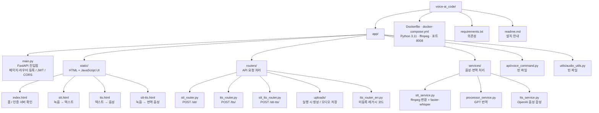

# voice-ai_code 프로젝트 구조

FastAPI 기반 음성 인식(STT)·번역(LLM)·음성 합성(TTS) 프로젝트입니다. 아래 내용은 현재 소스 코드를 기준으로 정리했습니다.

## 1. 프로젝트 구조

## 2. 주요 연결과 처리 흐름

실선은 구현된 연결, 점선은 통합 API에 남아 있는 TODO 연결입니다. 통합 API는 현재 파일 저장과 WAV 변환까지 수행하며 STT·번역·TTS 호출은 미완성입니다.

```mermaid
flowchart LR
    USER["사용자 / 브라우저"] --> UI["HTML + JavaScript"]
    UI --> AUTH["외부 Java 인증 서버 :8080<br/>로그인 / 인증 확인"]
    AUTH --> COOKIE["ACCESS_TOKEN 쿠키"]
    COOKIE --> JWT["FastAPI API 라우터의 JWT 검증"]

    UI -->|오디오 업로드| STT["POST /stt/"]
    UI -->|텍스트 입력| TTS["POST /tts/"]
    UI -->|오디오 + 목표 언어| PIPE["POST /stt-tts/"]
    JWT --> STT
    JWT --> TTS
    JWT --> PIPE

    STT --> CONVERT["stt_service.py<br/>ffmpeg: WebM → WAV"]
    CONVERT --> WHISPER["로컬 faster-whisper<br/>기본 small / CPU / int8"]
    WHISPER --> TEXT["인식 텍스트"]
    TEXT -->|STT 응답| UI

    PIPE --> PCONVERT["업로드 저장 / WebM → WAV"]
    PCONVERT -.->|Q03: STT 호출| WHISPER
    TEXT -.->|Q04: 통합 API에서 번역 호출| LLM["processor_service.py<br/>gpt-4o-mini"]
    LLM --> TRANSLATED["번역 텍스트<br/>영어·중국어·한국어·일본어·베트남어"]
    TRANSLATED -.->|Q05: TTS 연결| SPEECH["tts_service.py<br/>OpenAI tts-1 / nova"]

    TTS --> SPEECH
    SPEECH --> MP3["routers/uploads/*.mp3"]
    MP3 --> URL["GET /uploads/파일명"]
    URL --> PLAY["브라우저 음성 재생"]
```

## 3. 구현 상태

| 위치                                                       | 현재 상태                                            |
| ---------------------------------------------------------- | ---------------------------------------------------- |
| `app/main.py` Q01                                        | 페이지 인증용 JWT 검증 호출이 `None`으로 남아 있음 |
| `app/main.py` Q02                                        | `/stt-tts.html`의 인증 의존성 연결이 미완성        |
| `app/routers/stt_tts_router.py` Q03                      | 로컬 STT 서비스 호출이 `None`으로 남아 있음        |
| `app/routers/stt_tts_router.py` Q04                      | 번역 서비스 호출이 `None`으로 남아 있음            |
| `app/routers/stt_tts_router.py` Q05                      | TTS 서비스 호출이 `pass`로 남아 있음               |
| `app/routers/stt_router.py`                              | 개별 STT API의 서비스 호출과 JWT 검증 구현           |
| `app/routers/tts_router.py`                              | 개별 TTS API의 서비스 호출과 JWT 검증 구현           |
| `app/routers/tts_router_err.py`                          | 현재 `main.py`에 등록되지 않은 레거시 테스트 코드  |
| `app/api/voice_command.py`, `app/utils/audio_utils.py` | 빈 파일                                              |

통합 음성 번역 흐름은 Q03~Q05를 연결해야 완성됩니다. Java 인증 서버는 이 프로젝트 외부의 연동 대상이며, 코드에서 포트 8080과 `ACCESS_TOKEN` 쿠키를 참조합니다.
