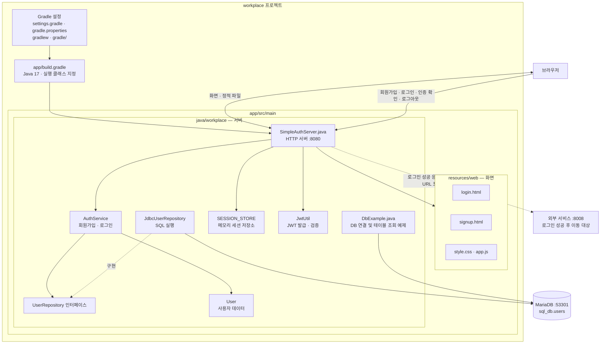

# workplace 프로젝트 구조

`workplace`는 Java 17 + Gradle 기반 인증 서버입니다. HTML 화면, 인증 서비스, MariaDB 접근 코드가 하나의 `app` 모듈에 들어 있습니다.

`AuthService`, `UserRepository`, `JdbcUserRepository`, `User`, `JwtUtil`은 모두 `SimpleAuthServer.java` 내부에 선언되어 있습니다.

현재 코드에는 로그인 연결, 세션 조회, JWT 검증 연결, 인증 거부 조건, BCrypt 처리에 TODO가 남아 있으므로, 다이어그램의 인증 흐름은 일부 미완성 상태입니다.
