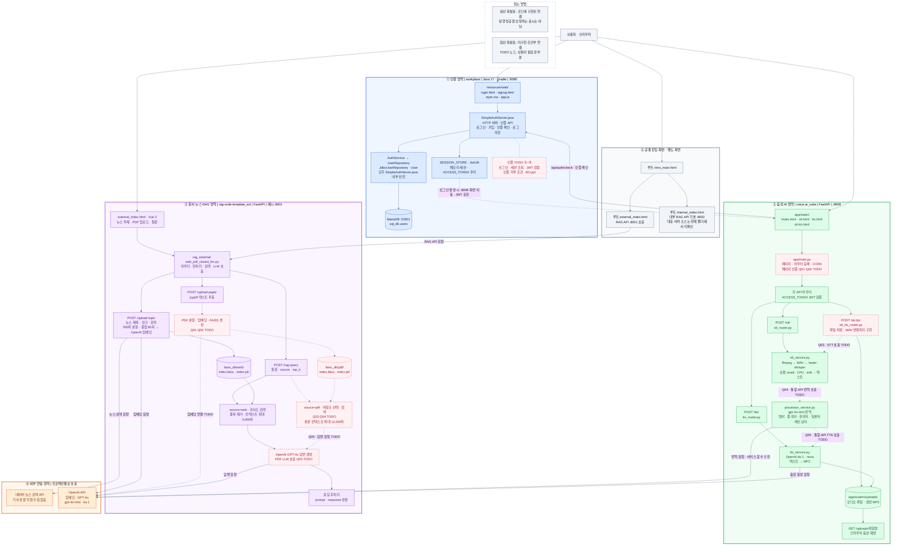

# 프로젝트 구조 — 통합 아키텍처

세 프로젝트의 `프로젝트 구조.md`와 현재 소스의 주요 연결을 하나의 Mermaid 다이어그램으로 통합했습니다. 인증, 음성 AI, RAG, 외부 연동, 공통 진입 화면을 색상과 영역 테두리로 구분했습니다.

## Mermaid 사이트에서 보기

1. [Mermaid](https://mermaid.ai/)에서 Mermaid 코드 편집 화면을 엽니다.
2. 함께 제공한 `프로젝트 구조.mmd`의 전체 내용을 복사해 붙여 넣습니다. 아래 코드 블록을 사용할 때는 시작과 끝의 백틱을 제외합니다.
3. 화면 맞춤과 확대 기능으로 전체 관계와 개별 영역을 확인합니다.

파랑은 인증, 초록은 음성 AI, 보라는 RAG, 주황은 외부 API, 회색은 진입 화면입니다. 분홍 점선 테두리 노드는 TODO가 포함된 구성요소입니다. 실선은 코드에 구현된 호출·참조 관계, 점선 화살표는 미구현 또는 조건부 연결입니다. 실선이 있어도 상위 인증 TODO 등에 의해 전체 실행이 막힐 수 있습니다.

## 통합 다이어그램

## 연결을 해석할 때

- `workplace`와 `voice-ai_code`는 인증 확인 API 및 `ACCESS_TOKEN` 쿠키로 연동하도록 작성되어 있습니다. Java 로그인·검증 TODO 때문에 현재 완성된 로그인 흐름으로 볼 수는 없습니다.
- RAG와 음성 AI 사이의 직접 호출, RAG와 Java 인증 서버 사이의 인증 연동은 확인되지 않아 연결선을 추가하지 않았습니다. OpenAI를 쓰는 공통점은 외부 API 영역에 표시했습니다.
- 루트 `intro_main.html`은 외부·내부 RAG 화면으로 연결합니다. `internal_index.html`은 기본 포트 8002를 참조하지만, 현재 세 프로젝트에는 대응하는 내부 RAG 서버 소스가 확인되지 않습니다.
- 음성 STT와 TTS의 개별 API 호출은 구현되어 있습니다. `STT → 번역 → TTS` 통합 API는 Q03~Q05 서비스 연결이 남아 있습니다. STT 결과 텍스트와 TTS 결과 음성은 해당 API 응답 및 브라우저에서 사용합니다.
- RAG의 웹 수집은 네이버 검색 결과의 제목·링크·요약을 사용합니다. PDF 경로는 Q01~Q05 구현이 필요합니다. FAISS는 시작 시 기존 파일을 로드하고 자료 수집 시 해당 저장소를 다시 생성·저장합니다.

## 실행·보조 파일

| 영역 | 파일·경로 | 역할·상태 |
| --- | --- | --- |
| 인증 | `workplace/settings.gradle`, `gradle.properties`, `gradlew`, `gradle/`, `app/build.gradle` | Java 17 빌드 및 실행 설정 |
| 인증 | `workplace/app/src/main/java/workplace/DbExample.java` | DB 연결·테이블 조회 예제 |
| 음성 AI | `voice-ai_code/Dockerfile`, `docker-compose.yml` | Python 3.11·ffmpeg·포트 8008 실행 환경 |
| 음성 AI | `voice-ai_code/requirements.txt`, `readme.md` | 패키지 및 설치 안내 |
| 음성 AI | `voice-ai_code/app/routers/tts_router_err.py` | 미등록 레거시 코드 |
| 음성 AI | `voice-ai_code/app/api/voice_command.py`, `app/utils/audio_utils.py` | 빈 파일 |
| RAG | `rag-code-template_ext/.env` | API 키·DB 연결 설정. 값은 이 문서에 포함하지 않음 |
| RAG | `rag-code-template_ext/requirements-e.txt` | Python 의존성 |
| RAG | SQLAlchemy MySQL 비동기 엔진 | 초기화 코드가 있으나 실제 API 처리에서 관계형 DB 사용은 확인되지 않음 |
| RAG | `faiss_db/`, `__pycache__/` | 벡터 데이터·실행 캐시. FAISS 경로는 실행 작업 디렉터리 기준, `.env`는 Python 파일 위치 기준 |

## 원본 문서

- [인증 프로젝트 구조](workplace/프로젝트%20구조.md)
- [음성 AI 프로젝트 구조](voice-ai_code/프로젝트%20구조.md)
- [RAG 프로젝트 구조](rag-code-template_ext/프로젝트%20구조.md)

원본 세 문서는 유지하고 이 문서를 통합본으로 추가했습니다.
